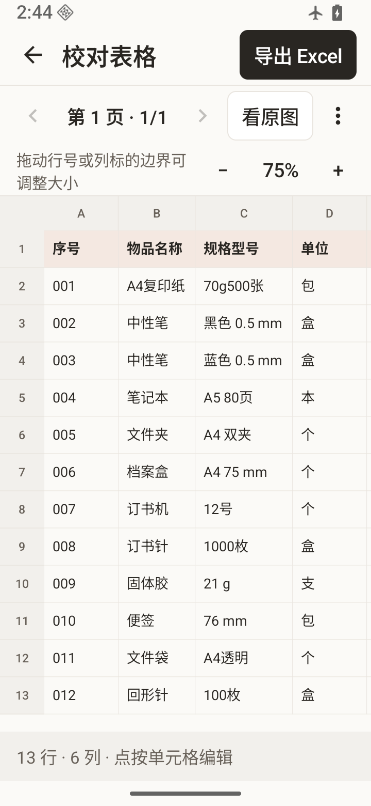

# 页光相机

页光相机是一款在 Android 手机上处理文档的扫描工具。拍下一页纸，或从相册选取一叠图片，可以校正纸张边角、减淡阴影、调整页序，再生成 PDF。中文印刷稿、手写稿和表格也可以先对照原图校对，再导出为可编辑的 Word 或 Excel 文件。



## 使用

**安装**　从最新版本的附件中下载 ARM64 APK，适用于 Android 9 及以上的 ARM64 手机。[下载页光相机](https://github.com/haoabcde/yeguang-camera/releases)

rc.13 保留全部功能与原始离线模型，ARM64 APK 从 231.7 MB 精简至 215.9 MB。下载大小与安装后的占用分别测量，详见[体积核验](docs/apk-size.md)。

rc.14 在转 Excel 前明确选择印刷或手写/混合模式，按页检查识别质量；明显不可靠时保留原图和旧稿，提示重试，不直接保存新表格。模型体量保持，详见[识别质量说明](docs/recognition-quality.md)。

rc.15 将拍摄目的前置：在相机选择扫描文件、扫描证件、提取文字、提取表格或扫码。文件、文字、表格默认连拍，点右下角缩略图进入逐页裁切；编辑后按当前任务保存或识别。底部「首页 / 文件 / 工具」分别处理新任务、已有资料和专项工具。

相机选择手写表格后：拍照或导入照片 → 右下角进入批次编辑 → 调整各页四角 → 提取表格 → 对照原图校对 → 导出 Excel。已有 PDF 转 Word/Excel 放在工具中，先校对再导出。详情可重开已有识别稿，重新识别先预览候选，不覆盖人工修改。

| 手头的材料 | 在应用中可以做什么 |
| --- | --- |
| 合同、资料或书页 | 单页或连续拍摄，拍前提示暗光、反光、移动及纸边；导入多张图片，调边、旋转、增强、整理页序，生成一个 PDF 或一张长图。单页书页可先对照预览曲面展平结果，应用后仍可恢复原稿。 |
| 有阴影的纸张、翻拍的显示屏 | 纸面可减淡阴影、增强字迹。屏幕文稿可单独处理常见的彩色摩尔纹。 |
| 中文印刷稿、手写便条 | 选择文字或手写识别，对照原稿改字，保存校对结果，导出 DOCX。 |
| 单据、手写清单 | 提取单元格，检查金额、编号与前导零；印刷表格结合格线与结构模型还原行列和合并格。手写结果保留原图位置，支持逐项确认、候选修正和按原图分列，导出 XLSX。表格可双指缩放、拖动行高列宽，显示设置随校对稿保存。 |
| 已有 PDF | 导入并阅读、旋转、重排、合并或拆分页面，也能取出图片、添加水印或签名图样。 |
| 已保存的扫描件 | 在本机按文档名、已识别正文或已校对的编号搜索，并回到命中页。 |

中文识别与增强在本机执行，模型随应用安装，首次识别也能离线完成。手写连笔、遮挡、反光及复杂表格可能导致错字、漏行或错列。处理证件号、金额等关键信息时，可在校对页直接查看原图。

## 本地构建

安装 JDK 17、Android SDK Platform 36 与 Build Tools 36.0.0，配置 `JAVA_HOME` 和 `ANDROID_HOME`，在项目根目录执行以下命令。

```sh
./gradlew :app:assembleDebug
```

调试 APK 输出至 `app/build/outputs/apk/debug/`。默认包含 ARM64 和 x86_64，指定 `-PscanAbis=arm64-v8a` 可仅构建手机版。首次构建需要下载 Gradle 与 Android 依赖。

[Android 验证方法](docs/validation.md) · [扫描功能调研](docs/quark-research.md) · [项目许可证](LICENSE) · [第三方声明](THIRD_PARTY_NOTICES.md) · [应用内附许可证](app/src/main/assets/licenses/)

安装包为验收版，使用开发验收签名；不同机型的相机与长表性能仍需实测。
