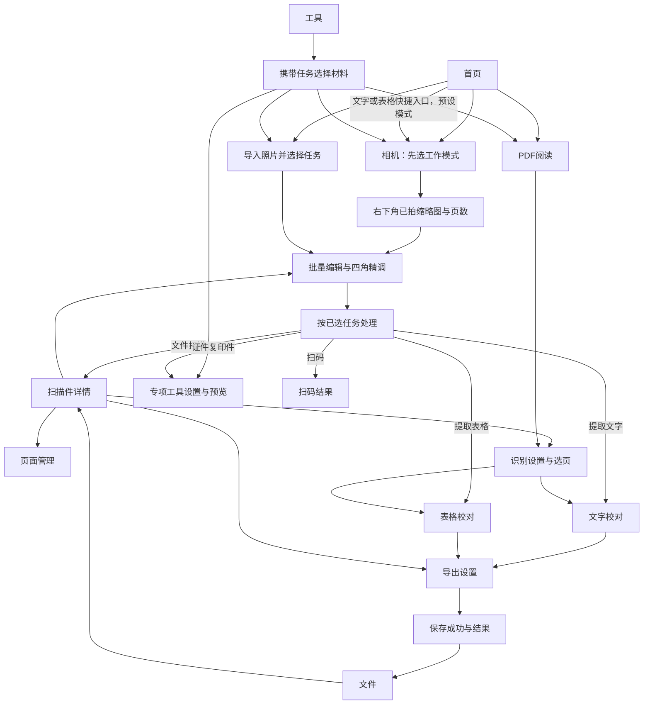

# 页光相机：页面内容与功能架构设计

设计日期：2026-11-22。修订：工作模式前置到拍摄界面，默认连拍，右下角进入逐页精调，保留更多工具。依据 rc.14 源码及本轮 Android 实际界面检查。本文保留批准的产品结构与页面目标。rc.15 按此实现主要工作流；实际验证范围与剩余边界以 docs/validation.md 为准，不改变现有 OCR、图像算法与模型体量。

## 1. 产品要帮助用户完成什么

用户打开应用主要做四件事：把纸张保存下来，把图片里的文字或表格变成可编辑内容，处理已有 PDF，再找到之前处理过的东西。

以这四件事组织页面。保留当前暖白、深色文字、克制棕色强调的视觉方向；此次重点是任务结构与操作路径。不给用户增加账号、会员、云同步或新的模型。

底部固定三个入口：**首页 / 文件 / 工具**。只在这三个顶层页面显示底部导航；进入拍摄、编辑、校对等工作页面后隐藏，避免误切任务。

| 顶层 | 回答的问题 | 主要内容 | 不承担的职责 |
| --- | --- | --- | --- |
| 首页 | 我现在要做什么、上次做到哪了？ | 拍照、导入照片、打开 PDF、提取文字、提取表格、继续处理 | 不堆全部工具，不展示长文件列表 |
| 文件 | 我之前的东西在哪里？ | 原扫描件、导入 PDF、识别稿、已导出记录；搜索和分类 | 不让用户去工具页找证件夹，不承诺索引整部手机 |
| 工具 | 我需要一个具体处理动作 | 文字与表格、图片处理、PDF 处理；按用途搜索 | 不放文件夹、不把同一个动作复制成多个功能 |

一个功能可以有首页快捷入口、相机模式、文件内入口和工具入口，但必须进入同一套流程，不能产生不同版本的设置和结果。

主流程原则：用户拍摄前即可选择工作模式；任务决定取景引导、拍摄数量及拍后去向。相册导入和已有材料沿用同一任务设置。导出阶段只处理文件格式、名称和保存位置，不承担首次选择识别任务。

## 2. 本轮现状核查

### 实际走过的路径

1. 校对表格 → 返回编辑：校对可以正常使用，但它是编辑流程中的隐藏结果页。
2. 编辑扫描件：裁切、旋转、增强可见；提取文字/表格在当前页不可直接发现。
3. 编辑 → 导出：PDF、图片保存与需要重新识别的 Word/Excel 混排；表格/手写表格、Word/手写 Word 平级重复。
4. 返回首页：首页有拍照、照片/PDF 导入及最近扫描；缺少明显的提取文字、提取表格和统一文件入口。
5. 全部工具：扫描、识别、书页处理、二维码混在一组；文件分类另占一个工具分类。

以上是此次实际截图与源码共同支持的判断，不是新用户测试结果。PDF 后续子流程及小工具的归属另按代码盘点，未将它们称为本轮逐项实机审查。

原始审查截图包含用户原稿，仅供本地验证，不随公开源码分发。

### 功能边界：哪些合并，哪些分开

| 现状或问题 | 设计决定 | 理由与边界 |
| --- | --- | --- |
| 提取表格 / 手写转 Excel | 合并为「提取表格」，内部选印刷 / 手写或混合 | 同一目标、同一校对和输出流程，识别模式不同；不合并底层识别器 |
| 提取文字 / 手写识别 / 手写转 Word | 合并为「提取文字」，内部选印刷 / 手写 | 识别文字与生成 DOCX 是连续步骤；复制文字不应先选 Word |
| 图片转 Word、PDF 转 Word 分散 | 共用提取文字设置与校对；保留输入类型 | 来源选择不同，不应有两套校对体验。PDF 接入校对是拟议改动，目前部分路径直接导出 |
| PDF、Word、Excel 同处导出菜单 | 分开「识别」与「导出」 | 识别产生可编辑稿；导出把当前结果保存成外部文件 |
| 书页展平在两处重复，书页拆分另列 | 一个「书页处理」入口，内部区分拆分与展平 | 同一书页场景，但两个动作不同；可只做其中一个，不能自动串联修改 |
| 扫描证件 / 证件照裁切 | 分开，改名「证件复印件」「证件照裁尺寸」 | 前者是身份证等正反面排版，后者是人像图片尺寸；不暗示已有 AI 抠图换底 |
| 裁切 / 矫正 / 旋转 | 图片编辑页同一「裁切与校正」工作区域 | 共用纸边、角度和预览；操作仍分别可撤销或取消 |
| 文档增强 / 拍屏去彩纹 / 手动消除 | 同属图片处理，保持独立选项 | 拍摄对象和处理风险不同；手动消除会去掉内容，不能当成普通增强自动执行 |
| PDF 合并 / 拆分 / 页面排序 | 共用页缩略图组件，保持明确任务和主按钮 | 合并是多文件进一文件，拆分是一文件出多文件，排序是改页序，不能只叫「选页」 |
| 多图转 PDF / PDF 合并 / 合并长图 | 三种输出任务分开 | 来源数量相似，但输出类型、页结构不同；不能只用「合并」一个含糊按钮 |
| 图片与 PDF 的水印、签名 | 工具目录各一个入口，按材料选编辑画布 | 复用文字或签名输入；图片定位与 PDF 页范围设置仍不同 |
| 证件夹、画册、会议资料、题目、错题本 | 移至文件分类 | 是内容容器，不是处理工具；不暗示具有题目识别或自动整理能力 |
| 修改原稿与导出图片副本混杂 | 明确「应用到扫描页」和「另存图片」 | 保存对象不同，预览页必须讲清；不能用同一个「完成」表示两种结果 |
| 提取表格与表格编辑 | 同一流程的不同页面 | 前者是识别配置；后者是对照原图修正，不应隐藏在另一个工具中 |

## 3. 页面与流程地图

主路径示例：

- 手写清单 → 首页「提取表格」→ 相机已选表格模式，拍前选手写或混合（也可同屏导入照片）→ 默认连拍/选图 → 点击右下角缩略图 → 逐页四角精调 → 开始识别 → 原图校对 → 导出 Excel → 保存位置与结果。
- 多图转 PDF → 导入照片 → 文档详情 → 管理页面 → 导出 PDF → 保存结果。
- 纸张有阴影 → 拍照/导入 → 文档详情「编辑图片」→ 增强 → 对比 → 应用 → 返回文档。
- 合并 PDF → 工具「合并 PDF」→ 选文件 → 页面管理 →「生成合并 PDF」→ 保存结果。
- 继续昨天的表格 → 首页「继续校对」或文件搜索 → 文档详情「表格稿」→ 回到上次位置。

## 4. 逐页内容设计

### P01 首页

- 顶部：页光相机、搜索；设置放文件页，首页不放一排杂项图标。
- 首屏：一个主按钮「拍照扫描」；其下「导入照片」「打开 PDF」两个辅助入口。
- 高频任务：并列「提取文字」「提取表格」，点击直达对应相机工作模式，同屏可导入已有照片。无需先理解 Word、Excel 格式。
- 继续处理：最多两项，显示缩略图、文档名、「表格还有 8 格未核对」等真实状态；无未完成任务时整块不显示。
- 最近打开：最多三项，「查看全部」进入文件。点击回到该对象，不强制进入图片编辑。
- 空状态：一句「拍张纸，或导入已有图片」和拍照/导入操作，不使用整屏教学轮播。

### P02 文件

- 顶部：文件标题、搜索、新建/导入、设置。
- 过滤：全部 / 扫描件 / PDF / 识别稿 / 已导出；这是同一资料的不同结果入口，不复制原图。
- 列表：缩略图、可理解名称、类型和页数、最近修改时间、待校对或原稿已更新状态。
- 分类：全部、未分类及现有证件夹等本地分类。分类是筛选，不和文件格式混在一排。
- 行更多：重命名、移动分类、查看关联结果、删除。长按进入批量选择；只显示当前支持的批量动作。
- 拟议新增导出记录，显示文件名和保存位置；目标文件被系统移动或删除时明确提示失效，可从原稿重新生成。
- 返回：保留过滤条件、滚动位置。删除需说明删除原稿还是某份结果；不顺带清理关联文件。

### P03 工具

- 顶部：工具搜索，支持常用说法，如「去阴影」「图片转表格」「拼 PDF」映射到现有动作。
- 三组：文字与表格、图片处理、PDF 处理。书页、证件是图片组中的明确场景。
- 每个入口包含名称和一句结果说明，例如「提取表格：生成可编辑 Excel」，不用技术模型名。
- 同一工具只有一个目录条目；水印与签名在进入后选材料类型。
- 文件分类不在这里。低频线稿、二维码等放组尾，不占首页首屏。
- 点击后携带任务进入 P05，不能选完材料又把用户丢回首页。

### P04 文档详情

- 通用扫描批次编辑完成和扫描件列表点击的承接页；相机已明确文字/表格任务时，先编辑拍摄页再开始识别，进入对应校对页；已有 PDF 直接进入 P12。顶部：名称、页数、更多操作。
- 主体「扫描页 / 识别结果」：扫描页是缩略图列表；识别结果列文字稿、表格稿及其待核对状态。
- 可见动作：编辑图片、管理页面、提取文字、提取表格；右上「导出」仅保存现有内容。
- 有表格稿时显示「继续校对表格」，有旧稿时显示「原图已更新」，不静默重识别覆盖修改。
- 文件名可修改，非必须填写；可以使用现有自动命名。多个同名结果显示版本/生成时间。
- 返回文件列表；从首页任务进入时，完成后提供「回到首页」，不连续退回多个弹层。

### P05 来源选择（底部面板）

- 标题带任务，例如「选择要提取表格的材料」。
- 当前文档、文件中选择、从相册导入、拍照、导入 PDF；按工具支持的材料显示，缺少当前文档时不显示空入口。
- 多材料任务显示已选数量与顺序。保留用户刚才选择的任务，不再询问一次同义的输出工具。
- 取消回到原入口，不创建空文档。

### P06 扫描拍摄与工作模式

- 相机本身就是任务入口。快门上方设置可横向切换的模式带：扫描文件、扫描证件、提取文字、提取表格、扫码。选中项清晰高亮，能看见相邻选项；不挤成一排小字，不把全部工具塞进相机。
- 首次从通用拍摄进入选「扫描文件」；首页文字/表格快捷入口预选对应模式。返回补拍保持当前任务；若记忆上次模式，下次打开必须清晰显示，不静默切换。
- 文件、文字、表格默认连续拍摄，不要求先切换单页/多页；拍一张也可直接进入下一步。证件保留正反面固定步骤，扫码保留内容结果流程，不套用普通文档批次。
- 文字模式在拍摄前显示「印刷 / 手写」；表格模式显示「印刷 / 手写或混合」。拍后不重复弹同一类型选择框；用户可在结果中主动修改后重新提取。
- 证件显示正面/反面引导、已完成槽位与合页预览；名称说明是证件复印件，和人像证件照裁尺寸分开。
- 取景区按模式给出针对性引导：文件看纸边，文字看字迹与阅读方向，表格提示包含完整行列，证件用比例框，扫码用识别区域。暗光、反光、晃动提示一次突出最关键的一项。
- 底部左侧为相册，中间快门，右下角为最新已拍照片缩略图与页数角标，标注「编辑 3 页」。每次快门成功加入当前批次后才递增页数，不自动离开相机；零页时缩略图入口禁用。相册导入继承当前任务。
- 用户点击右下角缩略图才进入批量编辑：缩略图切页、管理顺序、逐页自由拖动四角、旋转、增强。四角调整完成后，文件模式保存文档，文字/表格模式由明确按钮开始提取并进入校对；不在每次快门后自动 OCR。证件进入正反面排版，扫码进入内容结果。质量失败保留图片和调整，重拍不用重新选任务。
- 已拍页时切换模式，保留材料并提示处理范围；证件张数等条件不匹配时解释并让用户重新选择，不能静默丢照片。切换后完成按钮与引导必须同步更新，正在处理时不能串入另一模式的迟到结果。
- 右上保留「更多工具」，是工具目录快捷入口而非另一个拍摄模式。进入前保存当前批次、任务与每页调整，返回恢复原取景任务；不在有未保存批次时偷偷开始另一份 PDF 或清空照片。
- 当前 rc.14 的相机仅有单页/多页及拍前引导，以上任务模式带属于待实现设计。闪光灯和拍摄设置也属拟议补充。扫码已有拍照/图片识别；实时取景识码需要另行实现和验证，不能只加一个模式标签宣称已有。
- 返回有未加入文档的照片时提供保留/放弃；没有内容直接返回。退出与重拍均不改变此前已保存稿件。

### P07 图片编辑

- 标题显示「编辑第 2 页」与返回；中间是可缩放原稿；缩略图条切换页面。
- 底部可见：裁切校正、旋转、增强、更多。从已有文档进入时主按钮「保存修改」；从拍摄批次进入时，文件模式为「保存文档」，文字/表格模式为「提取文字（3 页）」或「提取表格（3 页）」。
- 拍摄批次进入编辑时默认展示当前页四角；四角可分别自由拖动做透视精调，提供角点放大镜和图像缩放，减少手指遮挡。另有自动裁边、重置、取消/应用裁切；不能同时出现含义不清的两个「完成」。
- 增强模式提供原色、增强及已有滤镜；对比原图保持同一缩放和位置。书页展平从更多或书页工具进入。
- 增强等可批量处理的选项显示「仅当前页 / 所有页」，跨页应用需确认。四角裁切必须逐页保存，不能把一张图的角点直接套给所有照片；未调整页仍保留自身自动裁边结果。原图始终保留，使用原分辨率生成结果，避免反复裁切损失。
- 批次编辑可「继续拍摄」，返回相机时保留页序和每页调整，补拍后追加。已有文档保存后返回 P04；文字/表格任务完成图片调整后进入提取。重做局部处理不把用户送去系统文件选择器。副本工具另走 P13/P18。

### P08 页面管理

- 统一页缩略图网格、页码、拖动排序、选择、旋转、移除、补拍/添加。
- 顶部明确任务：整理扫描页、合并 PDF、拆分 PDF。复用组件，不复用含糊任务标题。
- 主按钮随任务变化：「保存页序」「生成合并 PDF」「拆分为单页文件」。ZIP 输出提前说明。
- PDF 当前支持的选页另存与逐页拆分分别列清；不假装已有按复杂区间自动分成多份的能力。
- 未选页时按钮禁用并提示选页；移除仅影响本次副本/文档，删除整个源文件是另一个操作。

### P09 识别设置与选页（补充入口）

相机已选模式和文字类型时直接沿用，不强制再经过本页。此页主要服务已有文件、选页和主动更换识别方式。

- 顶部显示材料缩略图、文档名及选中页数；可进入选页。
- 明确任务「提取文字」或「提取表格」。文字模式印刷/手写，表格模式印刷/手写或混合。
- 相同文档再次进入优先展示该稿已有模式；始终可修改。设置不可用全局隐藏默认值替代可见信息。
- 已有修改稿时说明重新识别将生成新候选，成功后再决定替换；失败不覆盖旧稿。
- 主按钮「开始提取」。处理中显示当前页/总页与取消，不显示未经测量的百分比或剩余秒数。
- 表格质量失败提示具体页，提供看原图、调整图片、切换方式、重试。完整保留失败前的旧稿。将同等级页级质量门槛扩展到文字流程属于拟议改动，rc.14 尚未覆盖。文字类型仍由用户选择，不承诺自动判断字体。

### P10 文字校对

- 顶部：文档名、文字模式、页切换；主操作「导出 Word」，辅助「复制文字」。
- 原图/正文可切换，横屏可左右对照；数字核对是显眼辅助入口。
- 正文直接可编辑，本地保存状态只写「已保存到应用」；不冒充已生成外部 Word 文件。
- 重新识别放在更多，明确保留已有修改的处理方式。空读显示原图与重新提取入口。
- 返回 P04，结果稿保留；从单项任务直接进入的页面，也应能进入关联文档。

### P11 表格校对

- 顶部：文档名、页/表切换、当前印刷/手写模式；右上「导出 Excel」。
- 显眼区域：原图、未核对数、存疑数。「先核对存疑」直接可见，不藏在三点菜单。
- 表格：冻结行列标识、双指缩放、行高/列宽拖动；缩放值和恢复按钮收成一行。
- 单元格面板：原图局部、识别原值、编辑值、候选、确认/下一项；有候选不代表它更正确。
- 「调整分列」在无格线或推断布局时可见；先预览列数和保留项数，再应用，不能偷偷改文字。
- 错列、漏项和文字错误是不同问题，分别提供分列、补充/编辑、重新识别入口；未实现的补行/补列能力应在开发任务中明确，不能只画可点按钮。
- 导出前显示未核对状态。若支持导出未完成稿，应让用户明确选「导出当前草稿」。
- 新设计应让导出的草稿携带存疑标记/说明；rc.14 尚未带出高亮，此项属于体验缺口，不能在交付前宣称已有。

### P12 PDF 阅读

- 顶部文件名、搜索（仅在实际支持时显示）、更多。无可用文字检索能力时不画空搜索按钮。
- 大画面翻页、缩放，页码明确「第 3 / 12 页」。底部可见：管理页面、转换、导出。
- 拟议将转换接入提取文字/表格配置，先校对后输出；rc.14 的 PDF 部分转换仍直接出文件。PDF 内文字提取和扫描 PDF 的 OCR 在后台区分，不要求用户懂两种技术。
- 添加另一份 PDF 用于合并任务，不让阅读器默认成为无限追加、来源不清的全局工作台。
- 页序调整为文档副本，原 PDF 保留。多来源时页面管理显示原文件名和原页码。

### P13 专项工具设置

- 复用页面骨架：材料预览、工具专属参数、作用页范围、主操作「预览效果」。
- 证件复印件：正/反面槽位、补拍/重选、合页预览；不宣称证件字段自动录入。
- 证件照裁尺寸：现有一寸/二寸居中裁切、均匀纯色背景的有限换色；可拖动裁切框属于拟议改动；不宣称智能人像抠图或证件合规认证。
- 书页处理：分左右页 / 曲面展平两个独立选项，分别预览和应用，不强制同时运行。
- 等比改尺寸：宽高、锁定比例、输出尺寸；长图：顺序、拼接方向（仅显示已有能力）。
- 水印：内容、现有样式和范围；签名：绘制/清除、摆放预览、范围，不能和给文档签数字证书混称。
- 手动消除：画笔、撤回/清除选区、原图对照；线稿、拍屏去彩纹提供效果对比；二维码当前显示与复制识别值；确认后打开链接属于拟议补充。
- PDF 压缩显示输出大小的真实结果；不能提前写虚构压缩率。

### P14 导出设置

- 标题明确导出对象：扫描页、校对文字稿、校对表格稿、处理后的图片或 PDF。
- 只显示该对象可用格式。扫描页可 PDF/JPG/PNG，文字稿 DOCX，表格稿 XLSX；不把开启另一轮 OCR 当格式选择。
- 页范围、文件名、PDF 纸张与现有图片格式等相关参数；低频参数折叠，合理默认可直接保存。
- 主按钮「选择位置并保存」进入 Android 文件选择器。取消另存只取消外部文件保存，已校对稿仍留在应用内。
- 质量提示尽量集中为一块可操作信息，不连续叠加旧稿、未核对、再次确认三个同义弹窗。

### P15 保存成功与结果详情

- 只有系统写入成功才显示「文件已保存」。显示实际文件名、格式、大小、保存位置。
- 主要动作打开文件，辅助分享；「回到文档」可继续处理，「在文件中查看」回到对应记录。
- 草稿与正式校对结果明确区分；识别质量状态不能因为导出成功就变成已完成校对。
- 保存失败显示失败位置、重新选择位置/重试；不丢校对稿、不显示成功。
- 拟议增加持久化结果记录，应用重开后可在 P02 找到；失去系统 URI 权限时提示重新选择文件，不保存裸本机路径冒充可访问结果。

### P16 设置

- 本机存储：原稿、生成文件、临时缓存分别说明；清理缓存不删除原稿或校对内容。
- 权限：相机与系统选图/保存说明；需要时才请求，拒绝相机仍可导入图片。
- 默认导出设置只保存参数，文字模式以当前文档可见设置为准。
- 版本、开源许可证、隐私说明。不要添加尚未提供的账号、会员或云盘页面。

### P17 搜索

- 首页和文件入口共用。输入框说明「搜索名称或已提取文字」，不暗示未 OCR 图片也能全文搜索。
- 结果显示文件名、命中片段、命中页和稿件类型；点击定位命中对象，不只打开第一页。
- 保留现有「识别未处理页」能力：提示尚未提取文字的页数，由用户主动开始建立索引后再搜索，不在输入关键词时自动识别全库。表格单元格文字也纳入搜索；进一步精确定位格子属于导航改造。
- 无匹配给出清空筛选/修改关键词；有旧稿时不能把过期正文当成当前图的可靠结果。
- 返回保留来源页状态；搜索历史如保留须能清除，不默认展示私密识别全文。

### P18 处理结果对比

- 共用原图/结果切换、同步缩放、处理范围和结果说明；书页展平尤其保留页边与文字保护提示。
- 修改扫描页的流程：取消 / 应用到扫描页，应用后返回 P04/P07。
- 只生成副本的工具：返回调整 / 另存图片，保存后进入 P15；不得静默覆盖原扫描页。
- 风险检测不通过时保留原图，允许重新调整，不提供一个看似可用的空白结果。

## 5. 全量功能归属检查

| 现有功能 | 稳定入口 | 所属工作页面 |
| --- | --- | --- |
| 单页/多页扫描、相册导入 | 首页；文档补页 | P05/P06 → P04 |
| 裁切、自动裁边、旋转、增强、原色、屏纹处理 | 文档详情编辑图片；图片工具 | P07，特殊处理经 P18 |
| 图片/多图转 PDF，JPG/PNG 导出 | 文档详情导出 | P14 → P15 |
| 印刷/手写提取文字，生成 Word，复制 | 首页提取文字；文档详情；工具 | P09 → P10 → P14 |
| 印刷/手写表格，生成 Excel，原图校对、分列、拉伸缩放 | 首页提取表格；文档详情；工具 | P09 → P11 → P14 |
| 书页拆分、展平与恢复 | 工具书页处理；编辑页更多 | P13 → P18 |
| 证件正反面合页、证件照裁尺寸 | 图片工具两个独立入口 | P13 → P18 |
| 等比改尺寸、合并长图、线稿、手动消除 | 图片工具 | P13 → P18 |
| 图片/PDF 水印、手写签名图样 | 工具；文档内处理 | P13 → P18/P14 |
| 二维码读取 | 工具 | P05 → P13 的识别结果 |
| PDF 导入、阅读、旋转、选页、排序 | 首页打开 PDF；文件 | P12/P08 |
| PDF 合并、逐页拆分、选页另存 | PDF 工具；PDF 文档内 | P08 → P14 |
| PDF 转图片、长图、压缩 | PDF 工具；PDF 文档内 | P13/P14 → P15 |
| PDF 提取文字、转 Word/Excel | PDF 转换；识别工具选择 PDF 来源 | P09 → P10/P11（需改造） |
| 分类、重命名、删除、已校对全文/表格文字搜索、主动识别未处理页 | 文件 | P02/P17 |

## 6. 统一交互与状态

| 状态或动作 | 必须让用户知道什么 |
| --- | --- |
| 返回 | 回到上一层任务；输入与选页保留；不偷偷跳首页或清空 PDF 工作区 |
| 保存修改 | 原稿处理或校对内容保存到应用内，不代表外部文件已保存 |
| 开始提取 | 将读取哪几页、使用何种模式，是否涉及已有修改稿 |
| 取消处理 | 停止当前任务，保留原图/旧稿；不把未完成半批页当成成功 |
| 原稿已更新 | 原有识别稿可能与新图片不一致，可查看旧稿或重新提取 |
| 存疑与未核对 | 存疑是模型证据，未核对是人的工作状态，两者不能共用一个圆点含义 |
| 导出当前草稿 | 允许用户明确导出未核对内容，但需要保留质量提示；不自动改成已核对 |
| 写入失败 | 失败的是外部保存，应用内稿还在，并给出重新选择位置 |
| 空列表/无识别结果 | 给出当前任务唯一明确下一步，不留空白页或只显示「失败」 |
| 无权限/无外部阅读器 | 给相册导入、重新授权、系统分享等现有可行替代，不循环弹窗 |

交互可用性：主触点至少 48dp；正文默认不低于 14sp；存疑同时用文字和标记表达，不只靠颜色；检查 1.25/1.5 倍字体、横屏和长文件名。相机画面可深色，其余沿用暖白基底；每屏一个明确主操作，复杂参数收在其所属工作页。

## 7. 实施顺序与验收

P0：相机任务模式带及拍后直达、首页高频入口、三个顶层导航、文档详情、识别/导出分离、模式与保存语义、工具去重和文件分类迁移。先把功能找得到、操作走得通。

P1：统一来源选择与任务上下文、PDF 进入同一校对流程、可重开的结果记录、导出草稿携带存疑提示。需要资料索引和持久化设计，不只改界面文案。

P2：专项工具页面统一、搜索联想与帮助文案、大字体和横屏细节。保留低频能力，通过归组减少干扰，不以删除功能掩盖架构问题。

验收任务：手写图转 Excel、多图转 PDF、减淡阴影、合并 PDF、拆分 PDF、继续旧稿、找到已导出文件。每个任务测试从首页与已打开文档两种起点，覆盖首次/有历史数据、取消/失败/成功。

目标（尚未验证）：从首页最多两次点击到达核心任务入口或来源选择，不含系统授权、实际选图和校对；找 5 位未看说明的用户，至少 4 位能在 20 秒内找到各任务入口。记录实际点击、折返、求助位置，不以截图好看替代可用性通过。

发布检查：旧扫描件、PDF 工作副本、校对稿及导出 URI 关联不丢；原图、OCR 权重和识别精度不因导航改造改变；重识别失败保留修改。测试通过后再产生新的安装包，不能把此方案文件当作已完成重构。

## 8. 现状截图与逐步审查

原始审查记录仅供本地使用，不公开包含原稿的截图与附件。公开验收范围见[Android 验证方法](../docs/validation.md)。

## 9. 相机工作模式的取舍与验收

用户提供的夸克与系统识别入口例子用于学习「拍前先选目的」的产品逻辑，不是待开发功能清单。

| 建议首批模式 | 拍前选择与引导 | 拍后默认去向 | 导出时才选择的内容 |
| --- | --- | --- | --- |
| 扫描文件 | 默认连拍，普通纸张；书页可进书页处理 | 点右下角进入批次编辑、四角精调，再保存文档 | PDF、JPG/PNG及保存参数 |
| 扫描证件 | 正反面槽位与比例框 | 证件复印件合页预览 | 可用图片/PDF保存格式 |
| 提取文字 | 印刷/手写，默认连拍 | 点右下角精调图片，再开始提取、文字校对和复制 | Word文件名与保存位置 |
| 提取表格 | 印刷/手写或混合，默认连拍、完整行列引导 | 点右下角精调图片，再提取表格和校对 | Excel文件名、草稿状态及保存位置 |
| 扫码 | 扫码区域、相册入口；无单/多页 | 内容显示与复制；链接打开需确认 | 无需经过文档导出 |

「转文档」不另立一个含糊模式：生成扫描 PDF 属于扫描文件，变成可编辑 Word 属于提取文字。「书页」先作为文件扫描的场景选项，拆分与展平仍各自预览，不自动修改。证件照裁尺寸放工具页，避免与扫描证件混淆。

本轮不加入识图搜题、翻译、去手写、垃圾分类等未实现模式。手动消除不能命名为去手写；现有文件分类也不能命名为识图搜题。更多工具中只出现可用能力，不展示无法完成任务的占位入口。

同一张材料、同一工作模式，应获得一致的处理流程，和它来自相机、相册或已有扫描件无关。更换识别方式复用原图，不重拍；更换保存格式不重复 OCR；改了识别方式且已有人工校对内容时，先保留旧稿，再生成新结果。

验收至少覆盖：五个模式的入口/引导/完成按钮/结果页对应；文字和表格各两种类型；默认连拍一页/多页、右下角页数及编辑入口、逐页四角调整、相册导入；返回补拍；已拍材料切模式；处理中取消后切模式；失败重拍；旧稿保留。核心反例：在相机选手写表格后，拍完不能落到普通表格链路，也不能在导出时才第一次询问任务。

### 9.1 核心模式与更多工具的明确分工

| 入口 | 用户的出发点 | 首批内容 |
| --- | --- | --- |
| 相机工作模式 | 我正要拍摄，用它完成一项核心任务 | 扫描文件、扫描证件、提取文字、提取表格、扫码 |
| 更多工具 | 我有现成材料，要转换、组合或专项处理 | PDF 转 Word/Excel、合并、拆分、压缩、转图片/长图，水印、签名，图片改尺寸、证件照裁尺寸、书页处理、手动消除、线稿等已有能力 |

「工具」底部导航进入完整工具目录；相机右上「更多工具」访问同一目录，不复制第二套工具。相机模式入口要精简，工具目录要完整；PDF 转 Word 等以已有文件为输入的动作不放进相机模式带。

从更多工具选择具体任务后，按材料选择流程继续。例如 PDF 转 Word 选择或导入 PDF，而不是打开相机；图片水印可以选已有图片或拍摄，拍摄时携带水印任务，批次编辑后回到对应工具预览。对相机已有批次不适用的工具，先保留批次再开始新任务，返回时可以恢复。

### 9.2 拍摄与编辑交接的状态要求

- 已拍数量以成功保存到本次批次的图片为准；处理中的快门反馈与失败重拍提示清晰，不能出现数字增长但图片丢失。
- 右下角显示最新图与总页数，点击的含义固定为进入本次批次编辑，不直接分享、导出或只看最后一张。
- 默认打开最近拍摄页，缩略图条显示完整批次；新批次每页保留独立四角、旋转及增强参数。
- 拖四角时只改变当前页，支持取消和重置；缩放、拖拽图片与拖角点的手势不可互相抢操作。角点不能交叉形成无效四边形，接近边界仍有足够触控区域。
- 返回补拍、短暂切后台、相机/编辑来回切换均要保留已有页与调整。模式变更不能覆盖另一模式已有的人工校对稿。
- 正式提取或保存前，页数、工作模式、文字类型可见。工作模式在拍前已确定，编辑承担材料精调，导出仅决定文件保存方式。
